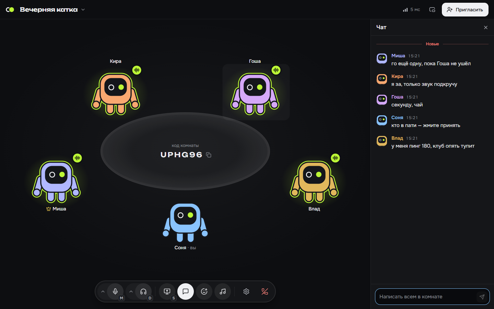
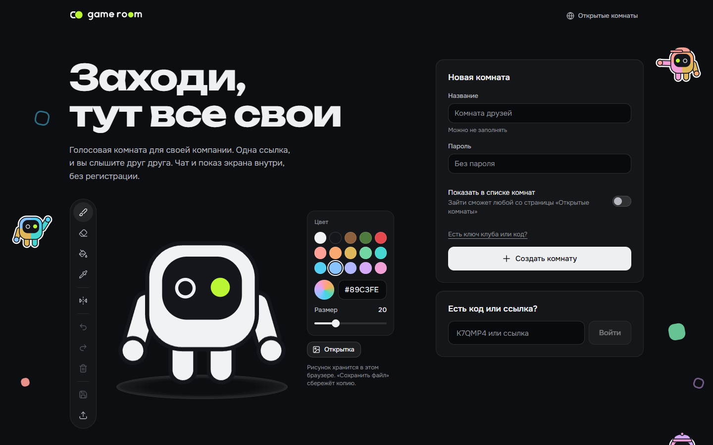
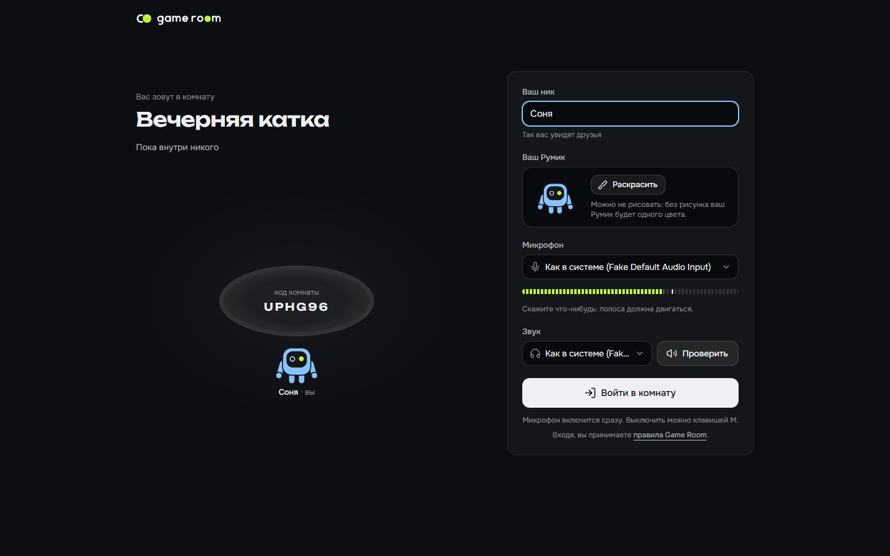
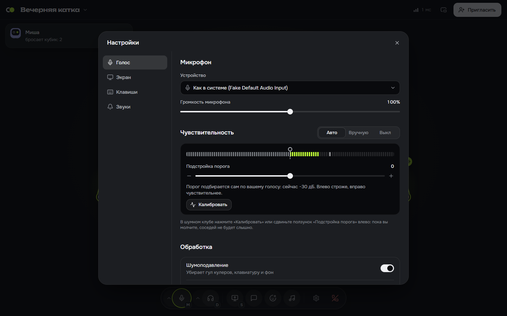
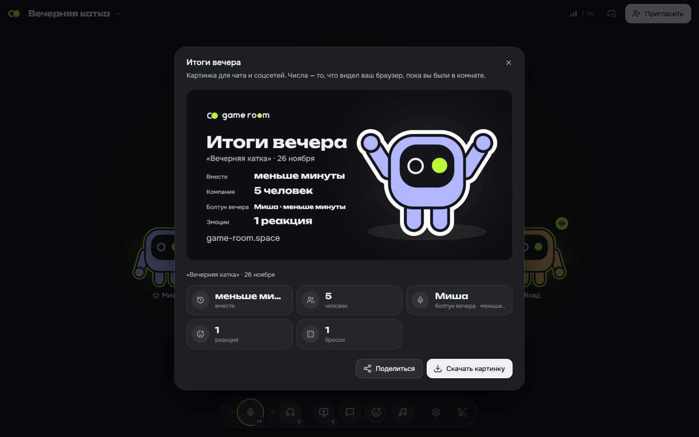

<h1 align="center">Game Room</h1>
<p align="center">Voice rooms for a group of friends: one link, no sign-up, own noise suppression, push-to-talk, screen sharing and a recap card after the evening.</p>
<p align="center">
  
  
  
  
  
</p>
<p align="center"></p>

The product is live at [game-room.space](https://game-room.space). The interface is in Russian.

## What it does

- **Rooms without registration.** Create a room, send the link, friends join through a lobby where they pick a nickname, an avatar and check their microphone. Optional password and a public rooms list.
- **Voice with its own processing chain.** RNNoise noise suppression, an automatic sensitivity threshold with a 3-second calibration, automatic gain, per-microphone voice profiles, per-participant volume.
- **Push-to-talk.** Hold a key (or the mic button on a touch screen) to open the mic; the release delay is configurable.
- **Screen sharing** with four profiles: 720p60, 1080p60, 1440p60 and a "text" profile for code and documents; share audio, full screen, zoom.
- **Host controls.** Kick, ban, mute, lock the room, password, who may share the screen or write in chat, hand over host rights.
- **Chat, reactions, soundboard, small games.** Chat history for late joiners, reactions over avatars, a soundboard with room-specific sounds, dice, "who pays?" and "is everyone ready?" polls, a status such as "playing: CS2".
- **Invites.** Share a link to Telegram, VK or Discord, show a QR code, or schedule a get-together with an `.ics` file and a Google Calendar link.
- **Recap card.** "Evening recap" renders a 1200x630 image (time together, people, reactions) to post in a chat or social network.

## Why it's interesting

- **A custom voice processor in an AudioWorklet** (`src/lib/audio/worklet`): 80 Hz high-pass, RNNoise (SIMD build), smart gate, envelope, own AGC, limiter. All DSP stages are plain TypeScript modules with unit tests (`dsp/*.test.ts`). The worklet is bundled by esbuild before `dev` and `build`.
- **Threshold that learns the room.** The gate estimates the background level and your voice level from frame statistics (percentiles of speech-probability frames) and sets the threshold from both; "Calibrate" does the same over a 3-second phrase and reports why it failed (no speech, too noisy, too quiet).
- **AGC that does not pump noise.** The gain moves only while your own speech is detected, so neighbours' voices are not lifted in your pauses; it lowers the level fast and raises it slowly. Browser AGC and noise suppression are switched off while ours runs, with a fallback to the browser's if the worklet fails to load.
- **Offline evaluation harness** (`scripts/audio-eval`): the same DSP code is run against synthetic scenarios (speech, a neighbour 15-25 dB quieter, keyboard, fans, 50 Hz hum) to compare settings and models; RNNoise was compared against GTCRN there (the reasoning is in [`docs/DECISIONS.md`](docs/DECISIONS.md), in Russian).
- **Self-hosting stack that mirrors production** (`deploy/`, `scripts/dev-stack`): LiveKit, Redis behind an Upstash-compatible REST wrapper, Caddy with TURN/TLS on port 443 via SNI routing and PROXY protocol v2. The update script refuses to restart anything while people are in rooms.
- **Tested at two levels.** 1275 unit tests in 126 files, plus 17 end-to-end scenario files where real Chrome instances with a fake microphone play speech, join rooms through the lobby and check what other people actually hear and see (voice, push-to-talk, chat, screen share, host actions, network loss, stand restart, CSP).

## Tech stack

| Layer | Tools |
|---|---|
| App | Next.js 16 (App Router), React 19, TypeScript, Tailwind CSS 4 |
| Realtime | LiveKit (`livekit-client`, `@livekit/components-react`, `livekit-server-sdk`) |
| Audio | Web Audio / AudioWorklet, RNNoise (`@sapphi-red/web-noise-suppressor`), esbuild |
| State and limits | Redis through the Upstash REST protocol, `@upstash/ratelimit` |
| Optional observability | Sentry, PostHog (both disabled when no keys are set) |
| Tests | Vitest, Playwright (`playwright-core` + system Chrome), offline audio benchmarks |
| Deploy | Docker Compose, Caddy, GitHub Actions (lint, type check, unit tests) |

## Screenshots

<table>
  <tr>
    <td><br><sub>Landing: create a room or enter a code</sub></td>
    <td><br><sub>Lobby: nickname, avatar, live microphone level</sub></td>
  </tr>
  <tr>
    <td><br><sub>Voice settings: auto threshold, calibration, noise suppression</sub></td>
    <td><br><sub>Evening recap image, ready to share</sub></td>
  </tr>
</table>

The screenshots are taken from a locally running copy with invented nicknames (`npm run screenshots`).

## Quick start

Requirements: Node.js 22, Chrome (for end-to-end tests), Windows, Linux or macOS. On Linux and macOS install `redis-server` first; on Windows the stand downloads one.

```bash
npm ci
npm run stack:fetch                        # once: LiveKit and Redis binaries into .dev-stack/
cp scripts/dev-stack/env.example .env.local   # dummy local keys, nothing real
npm run stack                              # LiveKit :7880 and Redis REST :8079 (Upstash-compatible)
npm run dev                                # http://localhost:3000
```

Open the site through `localhost`, not `127.0.0.1` (the Next dev server serves its scripts only to its own host name). Production variables are listed in `.env.example`; deployment is described in [`deploy/README.md`](deploy/README.md).

## Project structure

```
src/app/(site)/        landing, public rooms, legal pages
src/app/room/[code]/   the room: dock, participants, chat, stage, settings, host, recap
src/app/api/           token, rooms, chat flags, avatars, LiveKit webhook, internal API
src/lib/audio/         voice pipeline; worklet/dsp has gate, AGC, limiter, calibration
src/lib/room/          room logic, recap card data
src/components/ui/     design system components (Rumik mascot, dialogs, icons)
e2e/                   Playwright scenarios with fake microphones and a local stand
scripts/               dev stand (LiveKit + Redis), audio benchmarks, screenshots
deploy/                Docker Compose, Caddy, LiveKit config template, update script
design-system/         tokens and the written design system
remotion/              promo videos rendered from code
docs/                  decision log (Russian), detailed Russian README
```

## Tests & quality

```bash
npm run lint
npm run typecheck
npm test                      # 126 files, 1275 tests
npm run e2e                   # needs the stand and the site running; see docs/README.ru.md
node e2e/run.mjs --list       # list the scenarios
npm run audio:eval            # offline voice-chain benchmark
```

GitHub Actions runs lint, type check and unit tests on every push.

## Status & roadmap

- Live at [game-room.space](https://game-room.space); the core flows (rooms, voice, push-to-talk, chat, screen share, host controls) are covered by end-to-end scenarios.
- Soundboard, games and recap are behind runtime feature flags. The bundled sound pack is empty in this repository (`public/sounds/pack.json`), so the soundboard plays built-in synthesized sounds.
- Known limitation, from the decision log: if you stay silent for 1-5 minutes while a neighbour talks, the automatic threshold may drift toward the neighbour's voice.
- The interface and code comments are in Russian only. The operator's admin panel is not part of this repository; the site exposes an optional token-protected internal API (`/api/internal/*`) for it.


## License

MIT. See [LICENSE](LICENSE).

---
Built by [Nikita Lapa](https://github.com/nikito4kv) · built with an AI-assisted workflow
